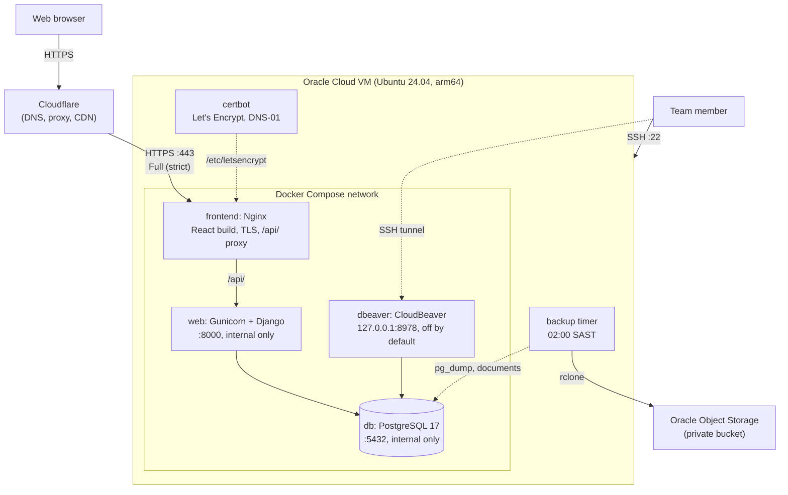

# Deployment

How the Smart Expense Tracker runs in production, and how to set it up, deploy it, roll it back, back it up and restore it.

Placeholders used below: `<domain>` is the site's hostname without `www`, and `<server ip>` is the server's reserved public IP.

## Architecture



- **Published ports:** `80` and `443` (Nginx) and `22` (SSH). Django, PostgreSQL and CloudBeaver are not reachable from the internet.
- **Nginx** is the only public server. It redirects HTTP to HTTPS, serves the React build, and proxies `/api/` to Django. `/admin/`, `/media/` and `/static/` return 404, and requests for any other hostname are dropped.
- **Gunicorn** serves Django with 3 workers of 4 threads each (`gunicorn.conf.py`). On `docker stop` it finishes the requests in progress, for up to 30 seconds.
- **Migrations** run in `entrypoint.sh` before Gunicorn starts. A failed migration stops the container.
- **Uploaded documents** live in the Docker volume `media`, and the database in the volume `postgres_db`. Both survive a rebuild.
- **Secrets** are files in `secrets/`, created by `generate_secrets.sh` and given to the containers as Docker secrets. They never enter git.
- **Cloudflare** proxies the site, which gives the CDN. Nginx still has its own Let's Encrypt certificate, so Cloudflare can be switched off without breaking HTTPS.

### Files

| File | Purpose |
|---|---|
| `docker-compose.yml` + `docker-compose.prod.yml` | The production stack. `COMPOSE_FILE` in `.env` joins them, so a plain `docker compose` uses both. |
| `.env.prod.example` | Template for the server's `.env`. |
| `start_prod.sh` | Generates secrets, builds and starts the stack. |
| `deploy/bootstrap.sh` | Prepares a new server: firewall, hardening, Docker. |
| `deploy/deploy.sh` | Backup, pull, build, start, health check. |
| `deploy/backup.sh`, `deploy/restore.sh` | Backups and restores. |
| `deploy/systemd/` | The nightly backup timer. |
| `receipt/nginx/prod.conf.template` | The production Nginx configuration. |
| `receipt/nginx/cloudflare-realip.conf` | Cloudflare's address ranges. |

## Environment variables

These are set in `.env` on the server (`chmod 600`, owned by `deploy`).

| Key | Value |
|---|---|
| `COMPOSE_FILE` | `docker-compose.yml:docker-compose.prod.yml`. Do not change; the scripts recognise a production `.env` by it. |
| `DOMAIN` | `<domain>`. Nginx serves it and `www.<domain>`, with the certificate in `/etc/letsencrypt/live/<domain>/`. |
| `DJANGO_DEBUG` | `0` |
| `DJANGO_ALLOWED_HOSTS` | `<domain>,www.<domain>`, with `<domain>` first. |
| `DJANGO_CORS_ALLOWED_ORIGINS`, `DJANGO_CSRF_TRUSTED_ORIGINS` | Empty. The website and the API share one origin. |
| `DJANGO_MEDIA_ROOT` | `/app/document_storage`, where the `media` volume is mounted. |
| `WEB_CONCURRENCY`, `GUNICORN_THREADS` | Gunicorn workers and threads per worker. |
| `POSTGRES_DB`, `POSTGRES_USER`, `DATABASE_HOST`, `DATABASE_PORT` | Database name, user and address inside Docker. |
| `PYTHONPATH`, `LOGLEVEL` | Parser import path and log level. |
| `DBEAVER_USER` | CloudBeaver login name. |
| `BACKUP_RCLONE_REMOTE` | Where backups are copied to, e.g. `oci:expense-tracker-backups`. Empty means on the server only. |
| `DBEAVER_PASSWORD`, `APP_UID` | Added by `start_prod.sh`. |

The Django secret key and the database password are not in `.env`. They are in `secrets/`.

## First-time setup

### 1. Oracle Cloud instance

1. Create a `VM.Standard.A1.Flex` instance: Ubuntu 24.04 (arm64), 2 OCPU, 12 GB RAM, boot volume of 50 GB or more, SSH key only.
2. Reserve a public IP and assign it to the instance, so the address survives a stop and start.
3. In the subnet's security list (or a network security group), allow inbound only:
   - TCP `22`, from your own address range if practical.
   - TCP `80` and `443` from each of [Cloudflare's ranges](https://www.cloudflare.com/ips/), so the server cannot be reached around Cloudflare.
4. Check Oracle's current policy on reclaiming idle Always Free instances and record the outcome here. Converting the tenancy to Pay As You Go, which stays free within the same limits, exempts it.

   > Outcome: _not yet recorded_

### 2. Prepare the server

Copy `deploy/bootstrap.sh` to the server and run it as the default `ubuntu` user:

```bash
scp deploy/bootstrap.sh ubuntu@<server ip>:
```

```bash
ssh ubuntu@<server ip> sudo bash bootstrap.sh
```

It updates the system, opens ports 80 and 443 in the host firewall and saves the rules, limits SSH to keys with no root login, turns on `fail2ban` and automatic security updates, sets the time zone to `Africa/Johannesburg`, installs Docker with log rotation, certbot and rclone, and creates the `deploy` user (in the `docker` group, with the same SSH keys as `ubuntu`), `/srv/expense-tracker` and `/mnt/data/backups/expense-tracker`.

Before closing the session, confirm from a second terminal that `ssh deploy@<server ip>` works.

### 3. DNS

In the Cloudflare dashboard for the domain:

1. Add a proxied (orange cloud) `A` record for the apex pointing to `<server ip>`, and a proxied `CNAME` for `www` pointing to the apex.
2. Enable DNSSEC.

Always SSH to the server by IP. The proxied hostname does not carry SSH.

### 4. Certificate

The certificate is issued with the DNS-01 challenge, so no inbound port is needed for it.

1. In Cloudflare, create an API token with the permission *Zone → DNS → Edit*, limited to this zone.
2. On the server, as `ubuntu`, store it where only root can read it:

   ```bash
   sudo install -m 600 /dev/null /etc/letsencrypt/cloudflare.ini
   ```

   ```bash
   sudoedit /etc/letsencrypt/cloudflare.ini
   ```

   The file has one line:

   ```text
   dns_cloudflare_api_token = <token>
   ```

3. Request the certificate. The hook makes Nginx load each renewed certificate.

   ```bash
   sudo certbot certonly --dns-cloudflare --dns-cloudflare-credentials /etc/letsencrypt/cloudflare.ini -d <domain> -d www.<domain> --deploy-hook "docker exec capitec_frontend nginx -s reload"
   ```

4. Check that renewal will work:

   ```bash
   sudo certbot renew --dry-run
   ```

### 5. Cloudflare settings

| Setting | Value |
|---|---|
| SSL/TLS mode | Full (strict) |
| Always Use HTTPS | On |
| Minimum TLS version | 1.2 |
| HSTS | Off in Cloudflare. Nginx sends the header. |
| Cache rule | Bypass cache when the path starts with `/api/` |
| Rocket Loader | Off |
| Web Analytics automatic injection | Off |
| Rate limiting rule | One rule on `/api/token/`, in front of the Nginx and Django limits |

Rocket Loader and Web Analytics inject scripts that the site's Content Security Policy blocks.

Cloudflare's free plan allows request bodies up to 100 MB and waits 100 seconds for a response. Nginx accepts 51 MB and Gunicorn gives a request 95 seconds, so both stay inside those limits.

### 6. Code and settings

As `deploy` on the server:

1. In GitLab, create a deploy token with the `read_repository` scope only (*Settings → Repository → Deploy tokens*), then clone with it:

   ```bash
   git clone https://<token name>:<token>@git.cs.sun.ac.za/Computer-Science/rw344/2026/Newspeak-RW344-Project.git /srv/expense-tracker
   ```

   If `git.cs.sun.ac.za` cannot be reached from the server, copy the code from a laptop with `rsync` instead, and deploy with `SKIP_PULL=1 deploy/deploy.sh`.

2. Create `.env`. The first run of `start_prod.sh` copies the template and stops:

   ```bash
   cd /srv/expense-tracker && ./start_prod.sh
   ```

3. Fill in `DOMAIN` and `DJANGO_ALLOWED_HOSTS` in `.env` (see [Environment variables](#environment-variables)).

4. Deploy:

   ```bash
   deploy/deploy.sh
   ```

   This generates fresh secrets in `secrets/` on the first run.

5. Set up backups: see [Backups](#backups).

## Deploying

As `deploy` on the server:

```bash
cd /srv/expense-tracker && deploy/deploy.sh
```

The script:

1. Runs `deploy/backup.sh` (skipped on the very first deploy).
2. Runs `git pull --ff-only`.
3. Runs `start_prod.sh`, which builds the images and starts the stack. Compose waits for Django's health check, which only passes once the migrations are applied and Gunicorn answers.
4. Polls `https://<domain>/api/health/` for up to a minute, first directly on the server's own Nginx and then through the public address. If either does not return `200`, it prints the container status and recent logs and exits with an error.
5. Removes unused images.

Options, given as environment variables: `SKIP_PULL=1`, `SKIP_BACKUP=1`, `SKIP_PUBLIC_CHECK=1` (for example before DNS points at the server).

Deploy from the branch that is checked out on the server. To change it, `git checkout <branch>` first.

## Rollback

1. Find the commit that was running before. `deploy.sh` prints the commit it deploys, and `git reflog` lists the previous ones.
2. Deploy that commit:

   ```bash
   deploy/deploy.sh <commit>
   ```

3. If the failed release applied a migration that the old code cannot run with, restore the database from the backup taken just before that deploy:

   ```bash
   ls -lt /mnt/data/backups/expense-tracker/daily/
   ```

   ```bash
   deploy/restore.sh live /mnt/data/backups/expense-tracker/daily/db-<timestamp>.dump
   ```

4. To go forward again once the fix is pushed: `git checkout <branch>`, then `deploy/deploy.sh`.

## Operations

Run these in `/srv/expense-tracker` as `deploy`.

| Task | Command |
|---|---|
| Status | `docker compose ps` |
| Logs | `docker compose logs -f web` (or `frontend`, `db`) |
| Django management commands | `docker compose exec web python manage.py <command>` |
| Database shell | `docker compose exec db sh -c 'psql -U "$POSTGRES_USER" -d "$POSTGRES_DB"'` |
| Stop Django gracefully | `docker compose stop web` |

The Django admin site is not served. Use `manage.py` for what it would do.

### CloudBeaver

CloudBeaver is not started by a deploy and never listens on a public address. To use it:

1. On the server:

   ```bash
   docker compose --profile admin up -d dbeaver
   ```

2. On your own machine, open a tunnel and browse to `http://localhost:8978/`:

   ```bash
   ssh -L 8978:127.0.0.1:8978 deploy@<server ip>
   ```

3. Log in as `DBEAVER_USER` from `.env` with the password in `secrets/dbeaver_password`. The database connection is host `db`, port `5432`, with the password in `secrets/postgres_password`.

4. Stop it when you are done:

   ```bash
   docker compose --profile admin stop dbeaver
   ```

### Certificate renewal

Certbot's own timer renews the certificate when it has under 30 days left, and the deploy hook reloads Nginx. To check: `sudo certbot certificates` and `systemctl list-timers certbot.timer`.

### Cloudflare address ranges

Cloudflare's ranges are listed in two places that must agree:

- The OCI security list, which lets only Cloudflare reach ports 80 and 443.
- `receipt/nginx/cloudflare-realip.conf`, which tells Nginx whose `CF-Connecting-IP` header to trust, so that rate limits and logs use the visitor's address.

When Cloudflare publishes a change at <https://www.cloudflare.com/ips/>, update both and redeploy.

### If Cloudflare fails

Open ports 80 and 443 to `0.0.0.0/0` in the OCI security list and switch the DNS records to "DNS only". The Let's Encrypt certificate keeps HTTPS valid. Rate limits keep working per visitor, because Nginx then sees visitors directly.

## Backups

`deploy/backup.sh` runs every night at 02:00 SAST and before every deploy. Each run:

1. Dumps the database with `pg_dump -Fc` to `/mnt/data/backups/expense-tracker/daily/db-<UTC timestamp>.dump`.
2. Checks the dump with `pg_restore --list`.
3. Archives the uploaded documents to `media-<UTC timestamp>.tar.gz` beside it, and checks the archive.
4. Keeps the first backup of each ISO week in `weekly/` as well.
5. Removes old backups: `daily/` keeps the last 7 days that have a backup, `weekly/` the last 4 weeks.
6. Copies `daily/` to the bucket named by `BACKUP_RCLONE_REMOTE`.

Files are readable by `deploy` only. Any failure removes the unfinished files and exits non-zero, which the timer records as a failed run.

### Nightly timer

Install it once, as `ubuntu`:

```bash
sudo cp /srv/expense-tracker/deploy/systemd/expense-tracker-backup.* /etc/systemd/system/
```

```bash
sudo systemctl daemon-reload && sudo systemctl enable --now expense-tracker-backup.timer
```

| Task | Command |
|---|---|
| Next run | `systemctl list-timers expense-tracker-backup.timer` |
| Run now | `sudo systemctl start expense-tracker-backup.service` (or `deploy/backup.sh` as `deploy`) |
| Logs | `journalctl -u expense-tracker-backup.service` |

### Off-site copy

Backups are copied to a private Oracle Object Storage bucket with rclone.

1. In OCI, create a private bucket, for example `expense-tracker-backups`, with a lifecycle rule that deletes objects older than 30 days. Lifecycle rules need a policy that lets the Object Storage service manage objects in the compartment; the console links to it when you add the rule.
2. Create an IAM user for backups, in a group whose policy covers this bucket only:

   ```text
   Allow group backup-writers to read buckets in compartment <compartment> where target.bucket.name='expense-tracker-backups'
   Allow group backup-writers to manage objects in compartment <compartment> where target.bucket.name='expense-tracker-backups'
   ```

3. Create a *Customer Secret Key* for that user. It gives the access key and secret for the S3-compatible API.
4. On the server, as `deploy`, create `~/.config/rclone/rclone.conf` with `chmod 600`:

   ```ini
   [oci]
   type = s3
   provider = Other
   access_key_id = <access key>
   secret_access_key = <secret key>
   region = <region>
   endpoint = https://<namespace>.compat.objectstorage.<region>.oraclecloud.com
   no_check_bucket = true
   ```

5. Set `BACKUP_RCLONE_REMOTE=oci:expense-tracker-backups` in `.env`, run `deploy/backup.sh`, and check the result with `rclone ls oci:expense-tracker-backups`.

Backups are copied, not mirrored, so deleting a backup on the server does not delete it in the bucket. The lifecycle rule is what removes old copies there.

### Restore drill

Proves that a backup can be restored, without touching the live site:

```bash
deploy/restore.sh drill
```

It restores the newest dump (or the one given as an argument) into a scratch database, prints how many tables, migrations, users, statements and receipts it holds, and drops the scratch database again.

> Last drill: _not yet recorded_

### Restoring the live site

```bash
deploy/restore.sh live <dump> [media archive]
```

This asks for confirmation, takes a backup of the current state, stops Django, replaces the database with the dump and, if an archive is given, the uploaded documents with its contents, then starts Django again. Django applies any migrations newer than the dump as it starts. The site returns errors for API calls while this runs.

To restore from the bucket, fetch the files first:

```bash
rclone copy oci:expense-tracker-backups/daily /mnt/data/backups/expense-tracker/from-bucket
```

## Verifying a deployment

| Check | Expected |
|---|---|
| `curl -I http://<domain>` | `301` to HTTPS |
| `curl https://<domain>/api/health/` | `200` with `{"status":"ok","database":"ok"}` |
| Log in, upload a statement over 1 MB, open it | Works, with no CSP errors in the browser console |
| `curl -m 5 http://<domain>:8978`, `:8000`, `:5433` | Time out |
| `https://<domain>/admin/`, `/media/` | `404` |
| `curl -m 5 -k https://<server ip>` from a non-Cloudflare address | Times out |
| Response headers | `server: cloudflare` and `cf-ray`; `/assets/*` gives `cf-cache-status: HIT` on a repeat request |
| `docker compose logs frontend` | Visitors' own addresses, not Cloudflare's |
| `docker compose stop web`, then its logs | `Handling signal: term`, and it exits within the 40 second grace period |
| Many quick requests to `/api/token/` | `429`, while another client is unaffected |
| Upload a scanned receipt | Completes without a Cloudflare `524` |

## Known limitations

- Login tokens are kept in the browser's `localStorage`. The Content Security Policy limits the risk from injected scripts.
- Django's email backend prints to the log, so no email is sent. `manage.py check --deploy` reports this as `mail.E001`. It also warns about HSTS and the HTTPS redirect (`security.W004`, `security.W008`), which Nginx does instead of Django.
- A document that is still being parsed when Django restarts is marked as failed and has to be uploaded again.
