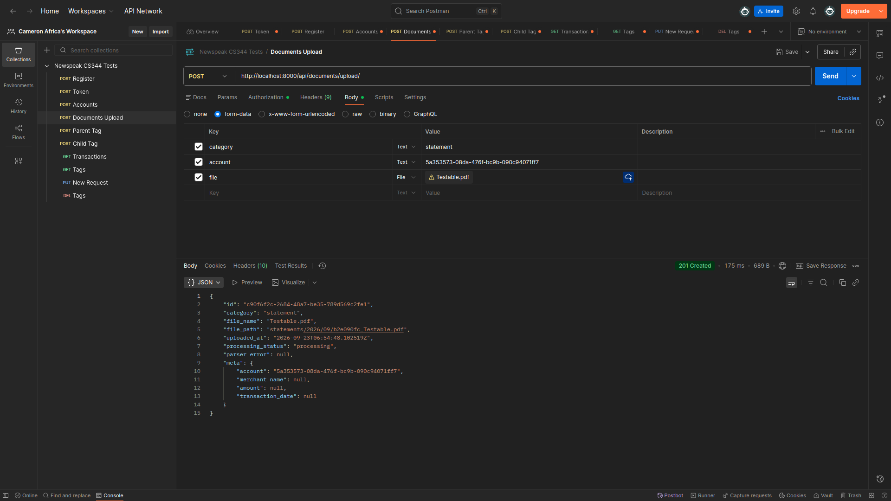
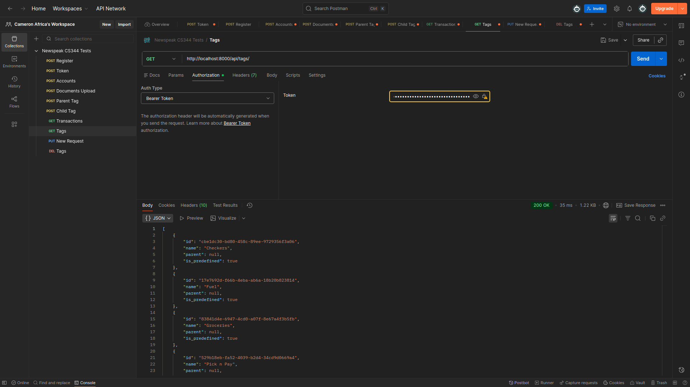
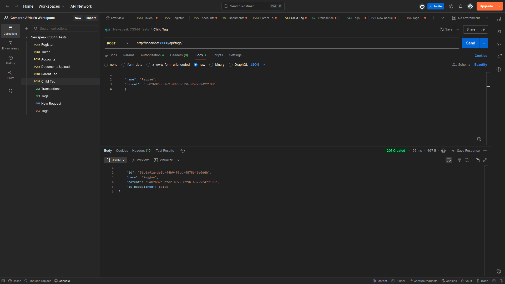
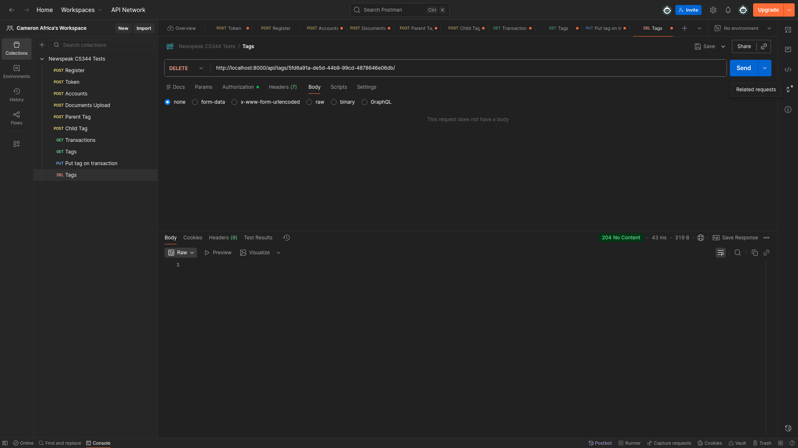
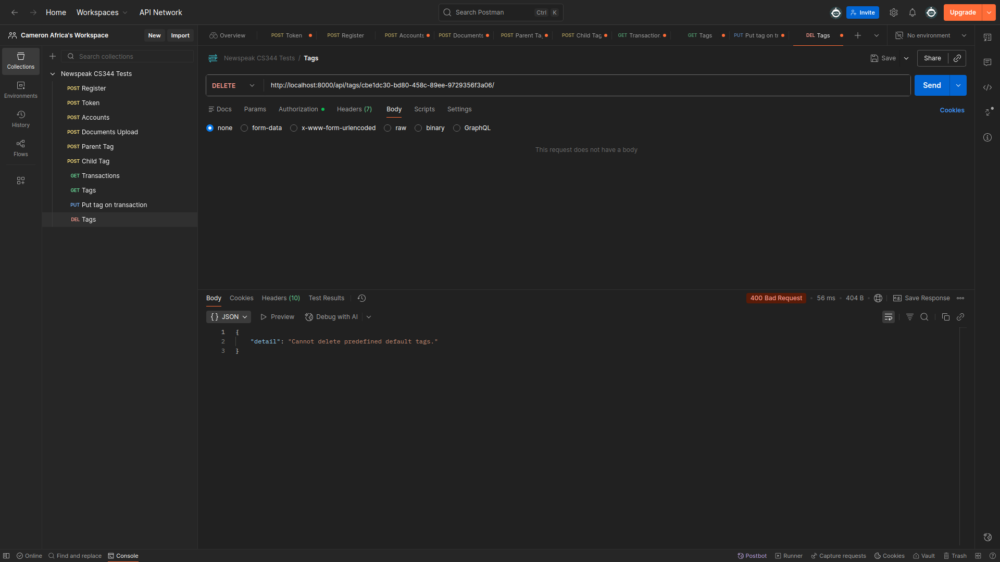
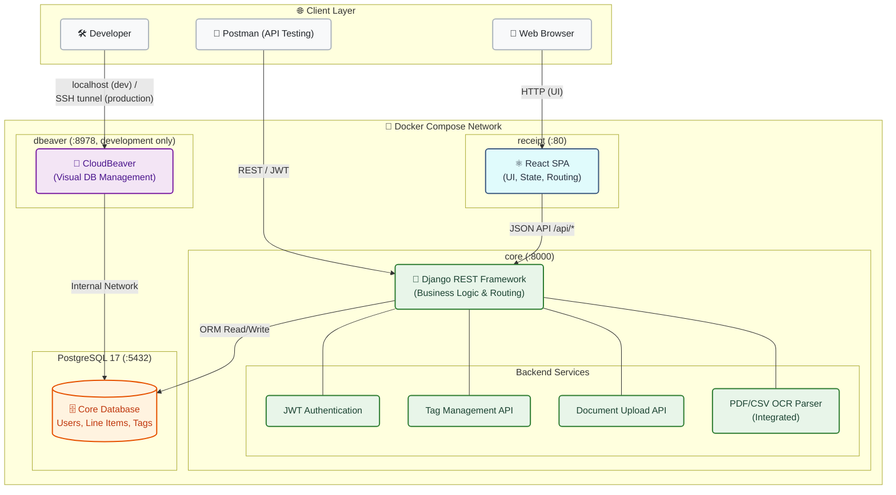

# Newspeak CS344 Project

## Team Members

- Fortunate Mgoila - 28294440
- Jean Durand - 27855651
- Cameron Africa - 28072502 
- Nathan Sparg - 28290151
- Malcolm Grewan - 27858421
- Leo Mischker - 28442644


## Overview

This project is a Django-backed application with a React frontend and a PostgreSQL database. The entire stack is orchestrated using Docker Compose.

This README covers running the project locally. For the live site (server setup, deploying, rollback, backups) see [DEPLOYMENT.md](DEPLOYMENT.md).

## Requirements

To run the project locally, you need:

- Docker
- Docker Compose

The Python dependencies used by the backend are listed in `requirements.txt`:


```text
asgiref==3.12.1
certifi==2026.7.22
charset-normalizer==3.4.9
dj-rest-auth==7.2.0
Django==6.1
django-allauth==65.19.0
django-cors-headers==4.9.0
django-rest-framework==0.1.0
djangorestframework==3.18.0
djangorestframework_simplejwt==5.5.1
idna==3.18
PyJWT==2.13.0
requests==2.34.2
rest-framework-simplejwt==0.0.2
sqlparse==0.5.5
urllib3==2.7.0
psycopg[binary]
camelot-py==2.0.0
click==8.4.2
et_xmlfile==2.0.0
mypy_extensions==1.1.0
numpy==2.5.2
opencv-python-headless==5.0.0.93
openpyxl==3.1.5
pandas==3.0.5
pillow==12.3.0
playa-pdf==1.1.0
pypdfium2==5.13.0
python-dateutil==2.9.0.post0
six==1.17.0
tabulate==0.10.0
annotated-types==0.8.0
cffi==2.1.1
cryptography==50.0.0
defusedxml==0.7.1
fonttools==4.63.0
fpdf2==2.8.8
img2pdf==0.6.3
lxml==6.1.2
markdown-it-py==4.2.0
mdurl==0.1.2
ocrmypdf==17.10.0
packaging==26.3
pdfminer.six==20260107
pi_heif==1.4.0
pikepdf==10.12.0
pluggy==1.6.0
pycparser==3.0
pydantic==2.13.4
pydantic_core==2.46.4
Pygments==2.21.0
rich==15.0.0
typing-inspection==0.4.4
typing_extensions==4.16.0
uharfbuzz==0.56.0
coverage
```

## Pulling the application

To create a local copy of the application, run the following command
:
```bash
git clone https://git.cs.sun.ac.za/Computer-Science/rw344/2026/Newspeak-RW344-Project.git
```

## Docker Services

The Compose file starts four services:

- `web`: Django application on port `8000`
- `frontend`: Frontend container served on port `80`
- `db`: PostgreSQL 17 database
- `dbeaver`: Browser-accessible DBeaver CloudBeaver on port `8978`

## Running the application

1. Create a `.env` file in the project root directory if it does not already exist.
2. Add the following database credentials to the `.env` file:

```text
POSTGRES_DB=postgres_db
POSTGRES_USER=postgres
```

The Django secret key and the database password are not kept in `.env`. They are generated into `secrets/` by `generate_secrets.sh`, which the startup scripts run for you, and reach the containers as Docker secrets. Run `./generate_secrets.sh` yourself before a manual `docker compose up`.
3. A startup script was provided (start_dev.sh) for Linux and macOS users that will build the containers and open the application in your default web browser in detached mode. Before running the script, make sure it is executable:
```bash
chmod +x start_dev.sh
```

4. Start the application:
```bash
./start_dev.sh
```

### Shared Demo Account

The development environment loads a shared demo dataset from
`demo/newspeak-demo.dump` when `./start_dev.sh` runs.

Use the following credentials to log in to the web application:

- **Username:** `newspeak_demo`
- **Password:** `NewspeakDemo2026!`

The account contains fictional financial data for testing transactions, receipts, and other application features.

**Important:** Every run of `./start_dev.sh` resets the configured local development database to the shared demo snapshot. Any database changes made locally since the snapshot was created will be lost. Source code and Git changes are unaffected.

These credentials are for local development and demonstration only.

The alternative manual Docker Compose startup does not automatically
restore the demo dataset.

**Alternative manual startup:** If you prefer not to use the *start_dev.sh* script, you can build and launch containers manually:
```bash
docker compose up --build -d
```

5. To shut down and stop all containers:
```bash
docker compose down
```

Access points:
**Web application:** `http://localhost/`
**Cloudbeaver Database UI:** `http://localhost:8978/`.

## Database Management via CloudBeaver

CloudBeaver runs directly inside Docker, requiring no local desktop installation.

1. Navigate to `http://localhost:8978/` in your browser (the startup script opens this automatically)

2. Log in using your administrator credentials. The default web login is:
- **Username:** `admin` (or your custom configuration)
- **Password:** `dbeaver` (or your custom configuration)

_To use a different web login, set `DBEAVER_USER` and `DBEAVER_PASSWORD` in `.env` before running `./start_dev.sh`_

3. Complete the initial setup by clicking `Next` and leaving the configurations default

4. Create a new PostgreSQL database connection using the internal Docker service network details:

```text
Host: db
Port: 5432
Database: postgres_db
Username: postgres
Password: <contents of secrets/postgres_password>
```

**Note:** The DBeaver container uses `db:5432` to reach PostgreSQL internally. Host-installed database clients connecting from outside Docker should use `localhost:5433` instead.

### Container user

Django does not run as root inside the `web` container. It runs as a user called `app`, whose id is the id of the host user who starts the stack: `start_dev.sh` and `start_prod.sh` write that id to `.env` as `APP_UID`, and the image is built with it. The ids have to match because the files in `secrets/` can only be read by their owner. For this reason the startup scripts refuse to run as root or with `sudo`. A manual `docker compose up --build` without `APP_UID` in `.env` uses id `1000`.

The code in the image belongs to root, so the app can only write to `document_storage/`, `tmp/` and `text_layered/`.

### Frontend image

`receipt/Dockerfile` takes two build arguments:

- `NGINX_CONF`: `dev` (the default) serves plain HTTP with `receipt/nginx/default.conf`. `prod` serves HTTPS with `receipt/nginx/prod.conf.template`.
- `VITE_API_BASE_URL`: the address the website calls the API on. A `prod` image must be built with `/api`.

A `prod` container needs the `DOMAIN` environment variable and the certificate for that domain at `/etc/letsencrypt/live/<domain>/`. It redirects HTTP to HTTPS, drops requests for any other hostname, proxies only `/api/` to Django, and limits how fast one visitor can call the API. `receipt/nginx/cloudflare-realip.conf` lists Cloudflare's address ranges, so that those limits apply to the visitor and not to Cloudflare; update it when Cloudflare publishes new ranges.

### Production settings

[DEPLOYMENT.md](DEPLOYMENT.md) is the full guide to the production setup. In short: the first run of `start_prod.sh` creates `.env` from `.env.prod.example` and stops, so that you can fill in the empty values such as `DJANGO_ALLOWED_HOSTS`. Later runs keep that file as it is. The script refuses to start with a development `.env`, which `start_dev.sh` writes on every run.

### Published ports in production

`start_prod.sh` publishes ports `80` and `443` only, and port `80` only redirects to HTTPS. Django (`8000`) and PostgreSQL (`5433`) are not reachable from outside Docker, so the API is called through Nginx at `https://<domain>/api/`, and `manage.py` and `psql` are run inside the containers:

```bash
docker compose exec web python manage.py createsuperuser
```

```bash
docker compose exec db sh -c 'psql -U "$POSTGRES_USER" -d "$POSTGRES_DB"'
```

### CloudBeaver in production

`start_prod.sh` does not start CloudBeaver, and the production stack never publishes port `8978` to the network. To use it, start it on the server:

```bash
docker compose --profile admin up -d dbeaver
```

It then listens on the server's loopback address only, so open an SSH tunnel from your own machine and browse to `http://localhost:8978/`:

```bash
ssh -L 8978:127.0.0.1:8978 <user>@<server>
```

Log in as `DBEAVER_USER` from `.env` with the password in `secrets/dbeaver_password`. Stop it again when you are done:

```bash
docker compose --profile admin stop dbeaver
```

## Testing the parser

Refresh the `core_bankstatement`,` core_receipt`, and `core_transaction` tables in CloudBeaver to observe parser processing. During a parser demonstration, upload a document in the web app and refresh the database row to watch its `processing_status` transition from `pending` -> `processing` -> `completed` (or `failed`). Parser failures are also logged in the web container:

```bash
docker compose logs -f web
```

## API Testing with Postman

You can test the backend endpoints directly using Postman.

1. **Register a User:** Send a `POST` request with raw JSON body data to `http://localhost:8000/api/register/`.

2. **Authenticate:** Send a `POST` request with your credentials to `http://localhost:8000/api/token/` to receive your JWT access token.

3. **Set Authorization:** In Postman, go to **Authorization** tab, select **Bearer Token**, and paste your JWT token to authenticate subsequent requests.

**Key endpoints:**

- **Accounts:** `http://localhost:8000/api/accounts/`
- **Document Upload:** `http://localhost:8000/api/documents/upload/`
- **Tags:** `http://localhost:8000/api/tags/`
- **Transaction/Line items:** `http://localhost:8000/api/line-items/`

## API Endpoint Testing (Postman)

The following tests demonstrate the core functionality and error handling of the Unified Document Upload API.

### 1. Successful Document Upload
**`POST /api/documents/upload/`**  
Accepts a `multipart/form-data` payload containing the file and document category. On success, the backend processes the file and returns the parsed line items.
- **Expected Status:** `201 Created`


### 2. Retrieve and Create Tags
**`GET /api/tags/` / `POST /api/tags/`**  
Demonstrates the endpoint used to fetch all available tags for a user (including predefined system tags) or to create a new custom tag. 
- **Expected Status:** `200 OK` (GET) or `201 Created` (POST)


### 3. Hierarchical Tag Creation
**`POST /api/tags/`**  
Showcases the ability to create sub-tags by passing a `parent` ID in the payload, allowing users to build a nested, hierarchical tag structure.
- **Expected Status:** `201 Created`


### 4. Successful Tag Deletion
**`DELETE /api/tags/{id}/`**  
Demonstrates a user successfully deleting a custom tag they own from their account. 
- **Expected Status:** `204 No Content`


### 5. Protected Predefined Tags
**`DELETE /api/tags/{id}/`**  
Validates the API's security logic by attempting to delete a global, predefined tag (like "Groceries"). The backend intercepts the request and safely rejects it.
- **Expected Status:** `400 Bad Request`


## Running tests and Coverage Reports

1. Ensure the Docker containers are actively running.

2. Make the test script executable:
```bash
chmod +x test.sh
```

3. Execute the test suite:
```bash
./test.sh
```
- Alternatively, if you want to run the script manually:
```bash
docker compose exec -T web python manage.py test core
```

### Checking Test Coverage

To measure test coverage using the `coverage` tool inside the container, run:
```bash
docker compose exec web coverage run manage.py test core
```

To view the detailed coverage summary report directly in your terminal:
```bash
docker compose exec web coverage report
```

## Project Structure

- `config/`: Main Django project configuration
- `core/`: Main backend application
- `receipt/`: Main frontend application
- `docker-compose.yml`: Multi-service local development setup
- `docker-compose.prod.yml`: Production overrides, layered on top of `docker-compose.yml`
- `deploy/`: Server setup, deploy, backup and restore scripts
- `DEPLOYMENT.md`: Production deployment guide

## Notes

- **Health Checks:**  Frontend and backend services feature automated health checks, waiting for the PostgreSQL database container to become fully healthy before booting up.
- **Django Superuser:** To access the Django administration panel at `http://localhost:8000/admin/`, create a superuser account by running: 
```bash
docker compose exec web python manage.py createsuperuser
```

## Architecture Diagram

This is the local development stack. In production only Nginx is published, over HTTPS, and CloudBeaver is reachable only through an SSH tunnel; see the diagram in [DEPLOYMENT.md](DEPLOYMENT.md).



---